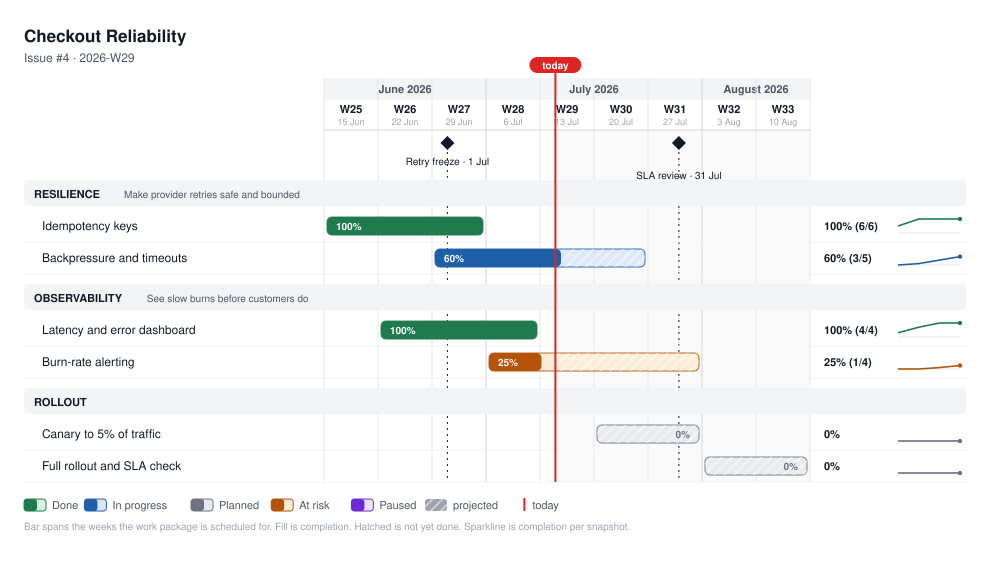

# Roadmap view: a swimlane chart from a TOML file

`/roadmap-new` writes a **Now / Next / Later** roadmap: prose and tables for the strategy
conversation. The roadmap view answers a different question: *where is each piece of work
right now, and when will it land?* It draws one bar per work package on a weekly grid, so
progress and slippage show up at a glance in a status update, a newsletter, or a chat post.

The two complement each other. Use Now / Next / Later to decide *what*; use the swimlane
view to report *how it's going*.

## What you get



- **Lanes** group work by direction (e.g. Resilience, Observability, Rollout).
- **Bars** span the weeks a work package is scheduled for. The solid fill is completion;
  the hatched remainder is work that is both undone and in the future.
- **Today line** and milestone diamonds anchor the grid in real dates.
- **Sparkline** (right column) shows completion at each past snapshot, so a stalled bar is
  visible even when its percentage looks fine.
- **Status colors**: `done`, `active`, `planned`, `at-risk`, `paused`.

## Quick start

1. Copy [`_templates/roadmap.toml`](../_templates/roadmap.toml) to
   `03-projects/{project}/roadmap.toml` and fill it in. Replace every `{{placeholder}}`;
   the template is not valid TOML until you do.
2. Validate: `python3 _tools/roadmap_render.py --data 03-projects/{project}/roadmap.toml --check`
3. Render:

   ```bash
   python3 _tools/roadmap_render.py \
       --data 03-projects/{project}/roadmap.toml \
       --out 10-reports/assets
   ```

This writes three files named after the `week` field: `roadmap-{week}.svg` (embed it in
Markdown), `roadmap-{week}.html` (standalone page with a detail table), and
`roadmap-{week}.png` (for chat tools that don't preview SVG).

A worked example lives in the demo vault:
[`roadmap.toml`](https://github.com/trustmaster/emos/blob/main/examples/demo-vault/03-projects/checkout-reliability/roadmap.toml)
and its [rendered output](https://github.com/trustmaster/emos/blob/main/examples/demo-vault/10-reports/assets/roadmap-2026-W29.svg).

## Keeping it current

The TOML file is the single source of truth. Each time you report progress:

1. Update `week`, `today`, and each package's `percent`, `status`, and `projection`.
2. Append one `history` entry per package (same number of entries on every row, oldest
   first). That is what drives the sparklines.
3. Re-render. Keep lane and package names stable between snapshots; regroup only when the
   work actually regrouped, and say so in your status update.

An agent can do steps 1 and 2 for you from a tracker export or your weekly notes, but
grouping tickets into work packages is a judgment call, so review the result.

## Data format

Top level: `title`, `week` (ISO week of this snapshot, required), `horizon` (first and last
week of the grid, required), and optionally `subtitle`, `issue`, `today` (defaults to the
current date), `epic` + `epic_label` (a link shown above the chart), and `[[milestones]]`
with `name` and `date`.

Each `[[lanes]]` has a `name`, an optional `note`, and one or more `[[lanes.packages]]`:

| Field | Meaning |
|-------|---------|
| `name` | Work package name |
| `start`, `end` | ISO weeks the package spans: when it ran, or the projection if planned |
| `status` | `done` · `active` · `planned` · `at-risk` · `paused` |
| `percent` | Completion, 0-100 |
| `done`, `total` | Optional ticket counts, shown as `60% (3/5)` |
| `projection` | Short text for the detail table: a date plus what makes it honest |
| `note` | One line of detail for the table, not the chart |
| `history` | `{ week, percent }` entries, oldest first |

`--check` also warns about packages that ended in the past but aren't finished, and about
packages at 100% whose status isn't `done`.

## Requirements

- **Python 3.11+** (uses the standard library only, no packages to install).
- **PNG output** needs one of `rsvg-convert`, ImageMagick (`magick`), or Chrome/Chromium on
  your machine. Without one, the tool skips the PNG; pass `--formats svg,html` to silence the
  warning.

## How it fits the framework

`_tools/roadmap_render.py` and `_templates/roadmap.toml` are framework files, managed by
`emos update`. Your `roadmap.toml` data files and rendered outputs are your own content and
are never touched. The tool is a plain script, not a skill: nothing in emOS calls it
automatically. The `roadmap-new` skill only mentions it as an optional step.
